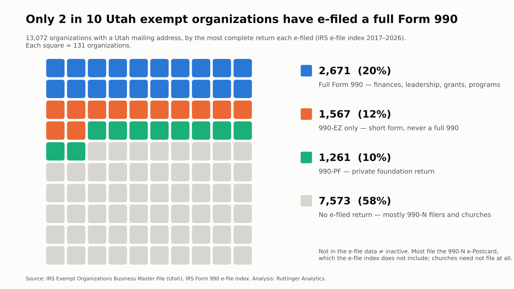
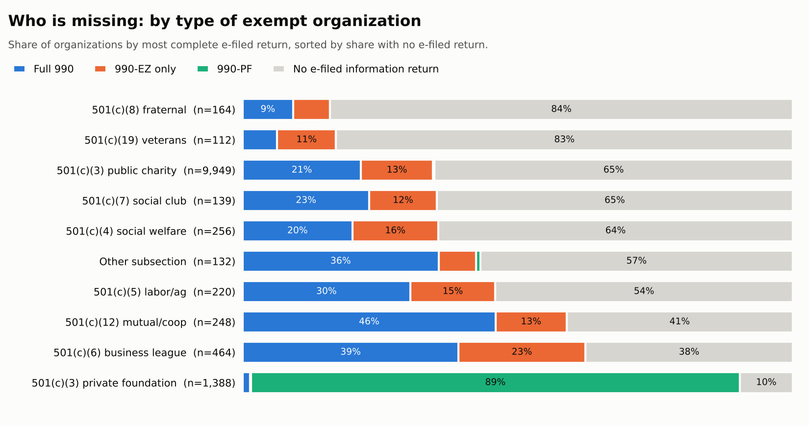
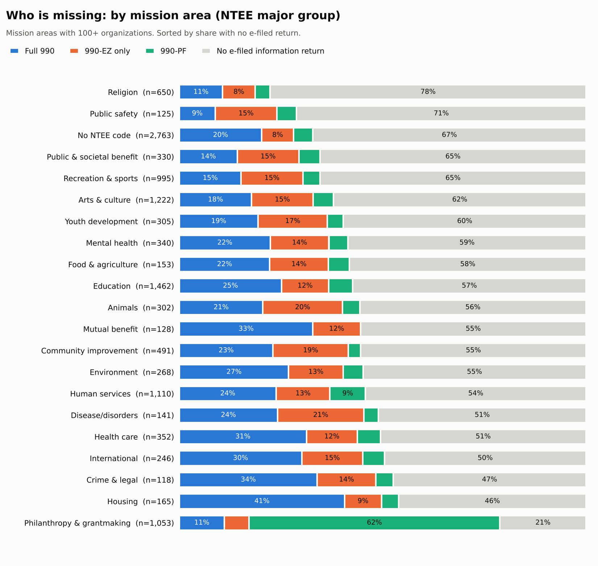

I've been building a database of Utah's tax-exempt organizations from public IRS data. It starts with the IRS Exempt Organizations Business Master File, the list of every organization the IRS recognizes as exempt, and joins it to the IRS index of e-filed Form 990-series returns. With a Utah mailing address as the boundary, that's **13,072 organizations**.

The first thing the data shows is how little of the sector it can see, and that's by design. Reporting rules are deliberately light for small organizations. One with gross receipts normally under $50,000 files a 990-N e-Postcard, and churches don't file at all. The trade-off is reasonable: small organizations rarely have an accountant on staff, and together they hold very little of the sector's money. Even if all 7,389 Utah organizations on the e-Postcard took in the full $50,000, they would total about $370 million, roughly 1% of the $32 billion in revenue the IRS records for Utah exempt organizations.

The other side of that trade-off is that almost no one looks. In fiscal 2025 the IRS examined 889 Form 990, 990-EZ and 990-N returns nationwide, out of about 1.8 million returns filed by tax-exempt organizations, or roughly 1 in 2,000 ([IRS Data Book, 2025](https://www.irs.gov/pub/irs-pdf/p55b.pdf), Tables 1-2 and 3-5). Since May 2024, Utah no longer registers charities that ask the public for donations.

For a small nonprofit, outside oversight is close to zero, so accountability rests almost entirely on the organization itself: its board, its funders, and its own records. That's why analytics maturity starts with clean, transparent data, not dashboards. Good records let you show donors what their money did, show the people you serve that you're delivering, and answer the IRS on the rare day it asks. When no one outside is checking, your own data is how you keep the public's trust.

## The number

{fig-alt="Waffle chart of 100 squares: 20 full Form 990, 12 990-EZ only, 10 990-PF, 58 no e-filed return."}

| Most complete return each organization has e-filed | Organizations | Share |
|---|---:|---:|
| Full Form 990 | 2,671 | 20% |
| 990-EZ only (short form) | 1,567 | 12% |
| 990-PF (private foundation) | 1,261 | 10% |
| No e-filed information return | 7,573 | 58% |

Only **2,671 organizations (20%)** have e-filed a full Form 990 since 2017. That's the version that reports revenue and expenses in detail, officers and their pay, grants made, and program accomplishments. Another 1,567 have filed only the short-form 990-EZ, and 1,261 are private foundations filing the 990-PF.

The other **58% have no e-filed information return at all.** (That includes 19 organizations whose only e-filing is a 990-T, a tax return on business income rather than an information return.)

## Who's missing, and why

Most of them aren't gone. The IRS master file records what each organization is required to file, and that explains almost all of the gap:

| Filing requirement for the 7,554 with no e-filed return* | Organizations | Share |
|---|---:|---:|
| 990-N e-Postcard (gross receipts normally $50,000 or less) | 6,290 | 83% |
| Church or religious organization, not required to file | 825 | 11% |
| Required to file a 990 or 990-EZ | 247 | 3% |
| Required to file a 990-PF | 129 | 2% |
| Other (older under-$25,000 code, government, group return) | 63 | 1% |

<small>*The 19 organizations that filed only a 990-T are counted with the filers here, because they have an e-filed record.</small>

- **The 990-N e-Postcard** is how small organizations meet their annual filing requirement. It confirms little more than a name, an address, a principal officer, and that gross receipts are under the limit. It isn't in the e-file index used here, and it carries no financial detail anyway.
- **Churches** aren't required to file a 990 of any kind, whatever their size. Many never apply for IRS recognition at all, so the master file undercounts them to begin with.
- **The 376 organizations required to file that have no e-filed return** could be new, late, covered by a group return, or on their way to automatic revocation. That small group deserves its own look.

## Which kinds of organizations are least visible

{fig-alt="Stacked bars by exempt organization type. Fraternal 84% and veterans 83% have no e-filed return; public charities 65%; business leagues 38%; private foundations 10%."}

Fraternal societies (84% with no e-filed return) and veterans' organizations (83%) are the least visible, followed by public charities (65%). Business leagues (38%) and private foundations (10%) are the most visible. Foundations have to file the 990-PF regardless of size.

{fig-alt="Stacked bars by NTEE mission area. Religion 78%, public safety 71%, recreation and sports 65%, arts 62% have no e-filed return; philanthropy 21% and housing 46% are the most visible."}

By mission area, religion (78%), public safety (71%), recreation and sports (65%), and arts and culture (62%) are the least visible. Philanthropy (21%) and housing (46%) are the most visible. One note: "Religion" here is a mission label from the IRS's NTEE classification, not the church filing status above. Many church-coded organizations have no NTEE code at all, and some religion-coded organizations are charities that do have to file.

## What it means

**For anyone who uses 990 data** (funders, researchers, journalists, and consultants like me), the detailed picture covers the larger fifth of the sector. Benchmarks built from Form 990 filings describe organizations big enough to file one: generally those with gross receipts of $200,000 or more, or assets of $500,000 or more. Smaller organizations can use the 990-EZ or, under $50,000, the postcard.

**For a small organization,** the public record says almost nothing about your work. Your mission, your programs, and the people you serve don't show up in any dataset someone else can download.

## What this says about analytics maturity

In maturity terms, this is the *data* stage: your own records are the only evidence of your work. It doesn't require a data warehouse or a dashboard. It requires a habit.

A practical first step: pick three things to record the same way every month (who you served, what you did, and one sign that something changed) and keep them in one place. Organizations that do this can answer a funder's question, spot a trend, or make a case to their board. Organizations that don't are invisible twice: once in public data, and again in their own.

## What the data can't see

- **Missing from e-file doesn't mean defunct.** Most of these organizations file the 990-N, which isn't in the e-file index, or are churches that don't have to file.
- **Paper returns aren't included.** E-filing became mandatory for tax years beginning after July 1, 2019, and for the 990-EZ for tax years ending July 31, 2021 or later ([IRS](https://www.irs.gov/charities-non-profits/annual-filing-and-forms)). Earlier paper filings don't appear.
- **"Utah" means a Utah mailing address** on the IRS record. That leaves out organizations headquartered elsewhere that serve Utah, and includes some that only use a Utah address.
- **About 21% of organizations have no NTEE mission code**, so the mission-area breakdown covers the rest plus a "No NTEE code" bar.

## Method

Data and classification

- **Organizations:** IRS Exempt Organizations Business Master File, Utah extract (`eo_ut.csv`), retrieved September 7, 2026. All exempt subsections; 87% are 501(c)(3).
- **Filings:** IRS Form 990 e-file indexes, 2017–2026 (`index_<year>.csv`). That's 34,584 filings matched to 5,518 Utah EINs.
- **Cross-check:** the IRS reports 12,569 tax-exempt organization returns filed in Utah in fiscal 2025 ([IRS Data Book, 2025](https://www.irs.gov/pub/irs-pdf/p55b.pdf), Table 1-3), in line with the 13,072 organizations in the master file.
- **Return types:** the index uses seven codes. Older index files label some returns `990O`, `990EO`, and `990PR`; the document locator number (DLN) prefix confirms these are a full 990, a 990-EZ, and a 990-PF. `990T` is the unrelated business income tax return.
- **Classification:** each organization is counted once, by the most complete return it has e-filed: full 990, then 990-PF, then 990-EZ, then 990-T only, then none.
- **Why not revenue size?** The master file shows $0 or no revenue for 72% of organizations, including nearly all non-filers, because it takes revenue from filed returns. The filing-requirement code is the better size signal.

## Where does your organization stand?

If public data can't tell your story, your own data has to. [Take the short analytics maturity assessment](https://clarkruttinger.info/assessment/?src=blog) to see where your organization's data practices are strong and where the next step is.

*Next week: how Utah nonprofits describe their impact, and how many describe outcomes rather than just counting people served.*
