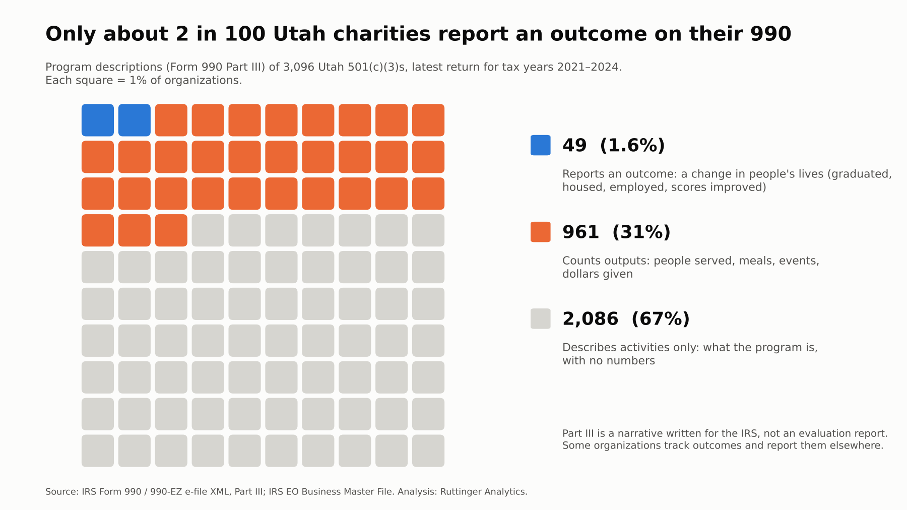
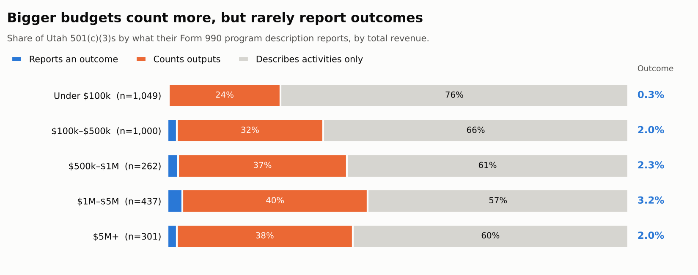

Every Form 990 has a section where the organization describes its programs in its own words. Part III asks for each major program's "accomplishments," and the 990-EZ asks for a "statement of program service accomplishments." The question invites an organization to say what changed because of its work.

I read what Utah's charities wrote there. In the filings I could see, most organizations describe what they do. About a third count what they did. **About 2 in 100 say what changed.**

## The number

{fig-alt="Waffle chart of 100 squares: 2 report an outcome, 31 count outputs, 67 describe activities only."}

| What the program description reports | Organizations | Share |
|---|---:|---:|
| Describes activities only (no numbers) | 2,086 | 67% |
| Counts outputs (people served, meals, events, dollars) | 961 | 31% |
| Reports an outcome (a change in people's lives or conditions) | 49 | 1.6% |
| **Total 501(c)(3)s with a usable description** | **3,096** | |

Here's what each category looks like. These are paraphrased composites, not quotes from any one filing:

- **Activities:** "Provides after-school tutoring to youth in the community."
- **Outputs:** "Served 412 students through 3,100 tutoring sessions."
- **Outcome:** "Of the 412 students, 78% raised their reading score by at least one grade level."

The outcomes that did appear were concrete: students who graduated or tested at grade level, families who moved into stable housing and stayed housed, participants who found jobs or raised their income, child-welfare cases that closed with children still at home, criminal records cleared, animals adopted. A few organizations reported survey results, such as the share of participants who said a program changed their knowledge or behavior.

## Size helps with counting, not with outcomes

{fig-alt="Stacked bars by revenue band. Outcome reporting is 0.3% under $100k, 2.0% at $100k to $500k, 2.3% at $500k to $1M, 3.2% at $1M to $5M, and 2.0% at $5M and up. Output counting rises from 24% to about 40%."}

Larger organizations are more likely to put numbers in their description. Output counting rises from 24% of charities under $100,000 to about 40% of those over $1 million. Outcome reporting barely moves. It's 2% among charities with $5 million or more in revenue, about the same as at $100,000.

That's the interesting part. Big organizations have finance staff, grant writers, and often an evaluation contract. They clearly *can* count. When it comes to the one question Part III invites, what changed, most of them answer the same way a volunteer-run league does.

## What it means

**For organizations,** the gap usually isn't effort or honesty. Counting outputs is the natural first step, because outputs live in records you already keep: attendance sheets, intake forms, the food bank's pounds log. Outcomes require something more: deciding in advance what change you're after, and then checking whether it happened, often after the person has left your program.

**For funders and boards,** the 990 isn't where outcomes live, and that's fine. But if the organization's own reports look like its 990, with plenty of activity and lots of counts but no result, that's worth a conversation.

## What this says about analytics maturity

This is the gap between *purpose* and *questions*, the first two stages of the maturity framework I use. Nearly every mission statement names a change: healthier kids, stable families, a cleaner river. Few organizations turn that change into a question they can answer with data: *Of the families we housed last year, how many are still housed?*

Until the question exists, there's nothing to measure, and no dashboard will fix that. A practical first step: for your largest program, write down one change you expect in the people you serve, how you'd know it happened, and when you'd check. One outcome, tracked consistently, beats ten outputs.

## What the data can't see

- **Part III is a narrative written for the IRS, not an evaluation report.** Many organizations measure outcomes and publish them in annual reports or grant reports instead. This finding is about what organizations choose to put in the public record, not what they know.
- **Some descriptions continue on Schedule O,** which isn't included here. I excluded descriptions that only said "See Schedule O."
- **The 990-EZ leaves less room.** Outcome reporting was 2.2% on the full 990 and 0.6% on the 990-EZ.
- **This covers only organizations that e-file a 990 or 990-EZ.** As post #1 showed, most of Utah's smallest organizations file the 990-N postcard, which has no program description at all.
- **The outcome count is close to a lower bound.** See the method notes below.

## Method

<details>
<summary>Data, classification and validation</summary>

- **Organizations:** Utah 501(c)(3) public charities in the IRS Exempt Organizations Business Master File with a 990 or 990-EZ e-filed for tax years 2021–2024. I used each organization's most recent return: 3,096 organizations, 1,900 full 990s and 1,196 990-EZs. 94% of the returns are for tax years 2023–2024.
- **Text:** All program-service descriptions on the return (Part III lines 4a–4d on the 990; Part III on the 990-EZ), joined together. Placeholder text ("See Schedule O," "N/A") was excluded.
- **Classification:** Three levels, assigned to the highest that applies. *Activities only* means no quantities. *Counts outputs* means quantities of service delivered (people, sessions, meals, events, dollars granted); years, grade ranges, ages and section numbers don't count. *Reports an outcome* means a specific, observed change for the people or conditions served: graduation, test results, housing or employment placement, measured improvement, a case resolved, an adoption. General claims ("youth gain confidence") without evidence don't count, and neither does completing a course.
- **Validation:** I hand-read a random sample of 200 descriptions. A rule-based classifier agreed with the hand labels on 192 (96%). Every description the rules flagged as an outcome (64) was then read and confirmed or rejected, and I read two further keyword sweeps (about 490 descriptions mentioning percentages, surveys, graduation, placement, housing and similar terms) to find outcomes the rules missed. That review found 49 outcome reporters.
- **Uncertainty:** In the hand-read random sample, 6 of 150 charities (4%) reported an outcome. That sample is small (95% interval roughly 1.5%–8.5%), and the full review may have missed some outcomes phrased in unusual ways. The honest summary is **between about 2% and 4%: fewer than 1 in 20.**
- **Revenue bands** use total revenue on the same return.

</details>

<details>
<summary>The classification rules (Python)</summary>

```python
# Outcome patterns (excerpt) — every match was then read by hand
R_PATS = [
  r'\d+%\s*(OF\s+)?(PARTICIPANTS|STUDENTS|CLIENTS|FAMILIES|GRADUATES|...)'
  r'[^.]{0,120}(REPORT|INCREAS|IMPROV|REDUC|GRADUAT|EMPLOY|HOUS|MAINTAIN|...)',
  r'(INCREAS|IMPROV|REDUC|DECREAS|GAIN)\w*\s+(OF|IN|BY)\s+\d',
  r'(GRADUATION|PLACEMENT|RETENTION|PASS|SUCCESS|RECIDIVISM)\s+RATES?',
  r'(ASSESSMENT|EVALUATION|SURVEY|DATA)[^.]{0,80}(INDICAT|SHOW|FOUND)[^.]{0,80}(GAIN|IMPROV|...)',
  r'(WERE ABLE TO|SUCCESSFULLY)\s+(CLOSE|KEEP|OBTAIN|SECURE|FIND|GRADUATE|...)',
]
# Output = any quantity left after removing years, ages, grade ranges, IRC sections, addresses
def classify(text):
    if any(p.search(text) for p in R_PATS): return 'outcome (review)'
    return 'outputs' if NUM.search(NOISE.sub(' ', text)) else 'activities'
```

</details>

## Where does your organization stand?

Moving from counting to outcomes is the step most organizations find hardest, and it's the one the assessment looks at most closely. [Take the short analytics maturity assessment](https://clarkruttinger.info/assessment/?src=blog) to see where your organization's data practices are strong and where the next step is.

*Next week: Utah's nonprofit boards are a small world. How many organizations share a board member with another, and what travels along those connections.*
