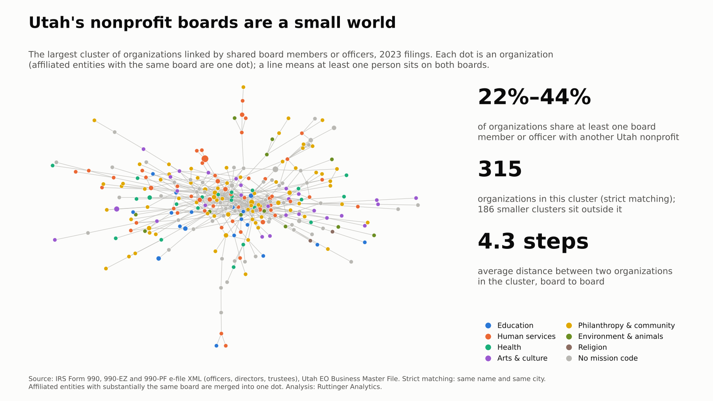
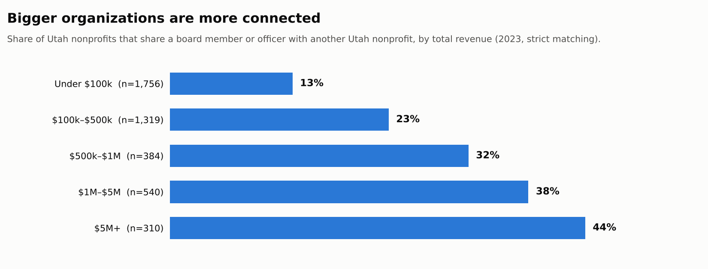

Every Form 990 lists the organization's officers, directors and trustees by name. Put those lists side by side and you can see something no single filing shows: the people who sit on more than one board, and the organizations they connect.

I did that for every Utah organization that filed a 990, 990-EZ or 990-PF for tax year 2023. In the filings I could see, **between a fifth and two-fifths of Utah nonprofits share at least one board member or officer with another Utah nonprofit.**

## The number

{fig-alt="Network diagram of the largest cluster of Utah nonprofits linked by shared board members, colored by mission area, with three statistics: 22% to 44% share a board member, 315 organizations in the cluster, 4.3 steps average distance."}

| 2023 filings | Strict matching | Loose matching |
|---|---:|---:|
| Organizations with a published board list | 4,341 | 4,341 |
| After merging affiliated entities | 4,156 | 4,126 |
| Share linked to another organization through a shared person | **22%** | **44%** |
| People who connect two or more unrelated organizations | 906 | 1,934 |
| Largest connected cluster | 315 organizations | 1,505 organizations |
| Average distance within that cluster, board to board | 4.3 steps | 5.5 steps |

Why two columns? The IRS lists people by name only, and names are a messy way to match. **Strict matching** counts two seats as the same person only if the name matches *and* both organizations file from the same city. That misses real people who serve on boards in two cities, so it's a floor. **Loose matching** uses the name alone. That joins different people who happen to share a common name, so it's a ceiling. The truth is somewhere in between.

I also merged **affiliated entities**: organizations whose boards are substantially the same people, like a charity and its supporting foundation, or a set of housing corporations run by one sponsor. Without that step, one family of organizations can look like a dense web of "connections" that are really one board wearing several hats. In 2023 that merged 294 organizations into 109 families.

## Bigger organizations are more connected

{fig-alt="Bar chart: share of organizations with a shared board member rises from 13% under $100k to 23%, 32%, 38% and 44% at $5M and up."}

Even with strict matching, 44% of organizations with $5 million or more in revenue share a board member with another Utah nonprofit, compared with 13% of those under $100,000. Full 990 filers are about twice as likely to be connected (32%) as 990-EZ filers or private foundations (15% each).

By mission area, housing organizations are the most connected (43%, though it's a small group of 63), followed by community improvement (31%), environment (30%), health (27%) and arts (27%) organizations. International (11%), animal-related (15%) and sports and recreation (15%) organizations are the least.

## What it means

**For organizations,** your board is a network, whether you use it that way or not. A director who also sits on another board brings that organization's habits with them: how it budgets, what it reports, which funders it trusts.

**For funders,** the connected core is where ideas travel fastest. A practice adopted by a few well-connected boards has a short path to many others.

**For anyone recruiting board members,** the pool is smaller than it looks. Between about 120 and 370 people (strict and loose matching) connect three or more unrelated organizations. That's a strength (experience) and a risk (fatigue, and the same voices everywhere).

## What this says about analytics maturity

Practices spread through board seats. In my experience, the moment an organization starts to *want* better data is often when a board member says, "At my other board, we see this every month." A finance committee chair who has seen a good dashboard asks for one. A director who has watched an evaluation change a program decision asks what yours would show.

That makes connected board members the sector's informal channel for analytics maturity. In stage terms, this is about *action and learning*: the habit of using what you find, which spreads person to person more than it's taught. If you serve on more than one board, you're already part of that channel. A practical step: bring one report, metric or meeting habit from your best-run board to your next meeting at another.

## What the data can't see

- **Names are imperfect.** Strict matching undercounts real connections, and loose matching overcounts them. I report both rather than guess.
- **Only organizations that list their board appear.** That leaves out 990-N filers and churches, which is most of Utah's smallest organizations (see post #1).
- **Some connections are by design.** A school's PTA and its foundation, or a hospital and its foundation, often share people on purpose. Merging affiliated entities removes the clearest cases but not all.
- **A connection isn't influence.** Two organizations sharing a treasurer doesn't mean they share practices, only that the path exists.
- **No individuals are named,** here or in the chart.

## Method

<details>
<summary>Data and matching</summary>

- **Seats:** Officers, directors and trustees listed on 2023 Form 990 (Part VII; key employees and former officers excluded), 990-EZ (Part IV) and 990-PF (Part VIII) e-filed returns of Utah organizations in the IRS Exempt Organizations Business Master File: 28,952 seats at 4,341 organizations. Institutional trustees (banks, trust companies) and non-person entries were removed.
- **People:** Names are normalized (uppercase, punctuation and suffixes such as JR, MD and CPA removed). Strict matching adds the filer's city.
- **Affiliated entities:** Two organizations are merged if they share at least two people and those people make up at least half of the smaller board.
- **Network:** Organizations (or merged families) are linked when at least one person sits on both boards. Distances are shortest paths within the largest connected cluster.
- **Revenue bands** use total revenue on the 2023 return.

</details>

<details>
<summary>The query (Cypher, against the Utah 990 graph)</summary>

```cypher
// Organizations that share at least one person in the same tax year
MATCH (o1:Organization)<-[r1:HAS_ROLE]-(p:Person)-[r2:HAS_ROLE]->(o2:Organization)
WHERE o1 <> o2 AND r1.tax_year = 2023 AND r2.tax_year = 2023
  AND o1.in_bmf AND o2.in_bmf
  AND (r1.is_director OR r1.is_officer OR r1.is_director IS NULL)
RETURN count(DISTINCT o1) AS interlocked_orgs, count(DISTINCT p) AS bridge_people;
```

The published figures add the same-city rule and the affiliate merge, which I ran in Python on the same tables.

</details>

## Where does your organization stand?

Your board's experience elsewhere is a resource. [Take the short analytics maturity assessment](https://clarkruttinger.info/assessment/?src=blog) and bring the results to your next board meeting. It's a good way to start the "how do they do it at your other board?" conversation.

*Next week: how old is the public picture of a nonprofit? The lag between the end of a fiscal year and the day its 990 becomes public.*
