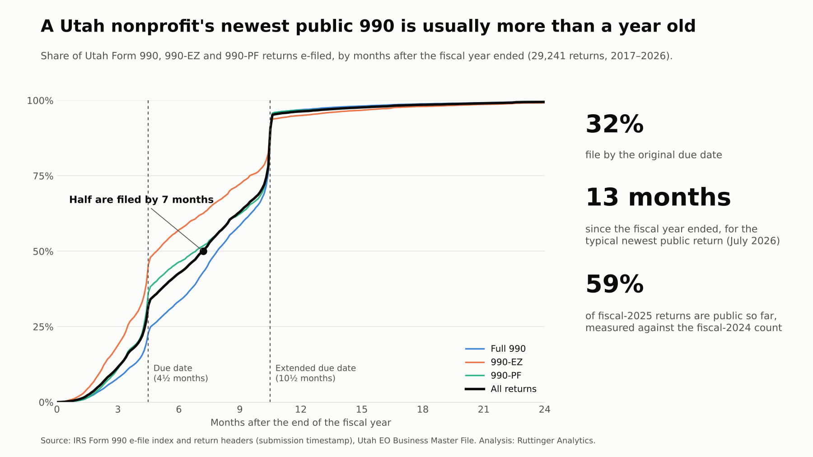
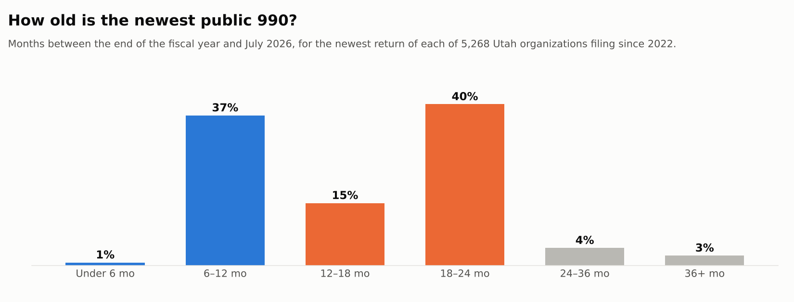

When a funder, a journalist or a prospective board member looks up a nonprofit, the 990 is usually the first thing they find. It's worth asking how current that picture is.

I measured the gap between the end of each Utah organization's fiscal year and the day its return was e-filed, for every 990, 990-EZ and 990-PF in the IRS e-file data since 2017. In the filings I could see, **the typical return is filed 7 months after the year ends.** For the typical organization, **the newest public return describes a fiscal year that ended 13 months ago,** so the activity it covers happened about a year and a half ago on average.

## The number

{fig-alt="Cumulative curve of returns filed by months after fiscal year end. 32% are filed by the 4.5-month due date, half by 7 months, and 91% by the 10.5-month extended due date, with a sharp jump just before the extended deadline."}

| From fiscal year-end to e-filing (29,241 returns) | |
|---|---:|
| Median | **7.2 months** |
| Filed by the original due date (4½ months) | 32% |
| Filed by the extended due date (10½ months) | 91% |
| Median, full Form 990 | 7.9 months |
| Median, 990-EZ | 4.9 months |
| Median, 990-PF | 6.8 months |

A 990 is due on the 15th day of the fifth month after the fiscal year ends, and one automatic six-month extension is available. **Most organizations use it.** Two out of three file after the original due date, and the curve jumps right before the extended deadline. The filing deadline, not the end of the year, decides when the numbers come out.

For an organization whose fiscal year matches the calendar year, that means:

| Calendar-year 2025 | Date |
|---|---|
| Fiscal year ends | December 31, 2025 |
| Original due date | May 15, 2026 |
| Extended due date | November 16, 2026 (the 15th falls on a Sunday) |
| Typical filing (7 months) | Late July 2026 |
| When the numbers describe | January–December 2025, on average mid-2025 |

Once a return is filed, the IRS isn't the bottleneck anymore. In the IRS's 2024–2026 data, e-filed returns are released in monthly batches, and the typical return appears in the batch for the same month it was filed. Almost all of the lag is the filing itself.

## How old is the newest public 990?

{fig-alt="Bar chart of the age of each organization's newest public return as of July 2026: 1% under 6 months, 37% 6 to 12 months, 15% 12 to 18 months, 40% 18 to 24 months, 4% 24 to 36 months, 3% 36 months or more."}

As of the IRS's July 2026 release, I looked at each of the 5,268 Utah organizations that have filed since 2022 and asked how old its newest return is:

- **62%** have a newest return for a year that ended 12 or more months ago.
- **47%** are 18 months or older. For most of these, the fiscal-2025 return isn't filed yet, so the newest public numbers are from 2024.
- Fiscal-2025 returns available so far: 2,810, or **59%** of the number filed for fiscal 2024. The rest will arrive through November.

## What it means

**For funders and researchers,** 990 data describes the recent past, not the present. A benchmark built today from 990s mostly reflects 2024, and only partly 2025. That's fine for structure (who funds whom, how boards are built) and weaker for anything that changes fast, like cash, staffing or demand.

**For organizations,** the public record of your work lags your actual work by a year or more. If your 2025 was a turnaround year, people researching you may not see it until late 2026.

**For boards,** the 990 isn't the last word on a year. It's the paperwork that closes it. Decisions about this year can't wait for it.

## What this says about analytics maturity

This one is about the *data* stage, and about whose data you decide with. The public sees you through a year-old filing. Your board shouldn't. The organizations that move fastest run on internal numbers that are a month old, not a year old: a monthly close, a few program measures updated on a schedule, a dashboard the board sees before every meeting.

A practical step: ask how long after a month ends your board sees that month's numbers. If the answer is more than six weeks, shortening it is one of the highest-value data projects you can do. It doesn't need new software, just a schedule and someone who owns it.

## What the data can't see

- **Filing isn't the same as publication.** I measure the e-file submission timestamp. In 2024–2026 the IRS's monthly release batch usually matches the filing month, but each batch is posted after that month ends, so public availability is somewhat later than shown here. Treat these lags as "at least."
- **Paper returns and the 990-N aren't included.** Paper filing was common before e-filing became mandatory (tax years beginning after July 1, 2019 for the 990; 2021 for the 990-EZ), so the earliest years in the data lean toward organizations that already e-filed.
- **Amended returns** are counted once, at the original filing.
- **The fiscal-2025 comparison** assumes a fiscal-2025 cohort about the size of fiscal 2024. Recent cohorts have grown about 5% a year, so 59% is, if anything, generous.
- **"Utah"** means a Utah mailing address on the IRS master file.

## Method

<details>
<summary>Data and calculations</summary>

- **Returns:** IRS Form 990 e-file indexes 2017–2026 (download of September 7, 2026; latest release batch July 2026), filtered to Utah organizations in the EO Business Master File. Information returns only (990, 990-EZ, 990-PF, including the older 990O/990EO/990PR labels); one return per organization and fiscal period, keeping the first filed.
- **Fiscal year-end** is the index `TAX_PERIOD` (year and month). **Filing date** is the `ReturnTs` timestamp in the return header. Lags are in months of 30.44 days. I kept returns filed 0–60 months after year-end (29,241).
- **Release batch** is the IRS `XML_BATCH_ID` month, available for the 2024–2026 indexes.
- **Age of newest return:** for each organization with a fiscal year ending in 2022 or later, the time from its latest fiscal year-end to July 31, 2026.

</details>

<details>
<summary>The calculation (Python)</summary>

```python
x["fy_end"] = pd.to_datetime(x.TAX_PERIOD + "01", format="%Y%m%d") + pd.offsets.MonthEnd(0)
x["filed"]  = pd.to_datetime(x.return_ts.str[:10])
x["lag_months"] = (x.filed - x.fy_end).dt.days / 30.4375
x = x.sort_values("filed").drop_duplicates(["EIN", "TAX_PERIOD"])   # first filing only
x.lag_months.median()                    # 7.2
(x.lag_months <= 4.5).mean()             # 0.32  original due date
(x.lag_months <= 10.5).mean()            # 0.91  extended due date
```

</details>

## Where does your organization stand?

How current are the numbers your board decides with? [Take the short analytics maturity assessment](https://clarkruttinger.info/assessment/?src=blog). It asks about reporting rhythm and data timeliness, and shows where your organization's next step is.

*Next week: who funds Utah. How concentrated grant dollars are among the state's largest grantmakers, and why that matters for what nonprofits measure.*
