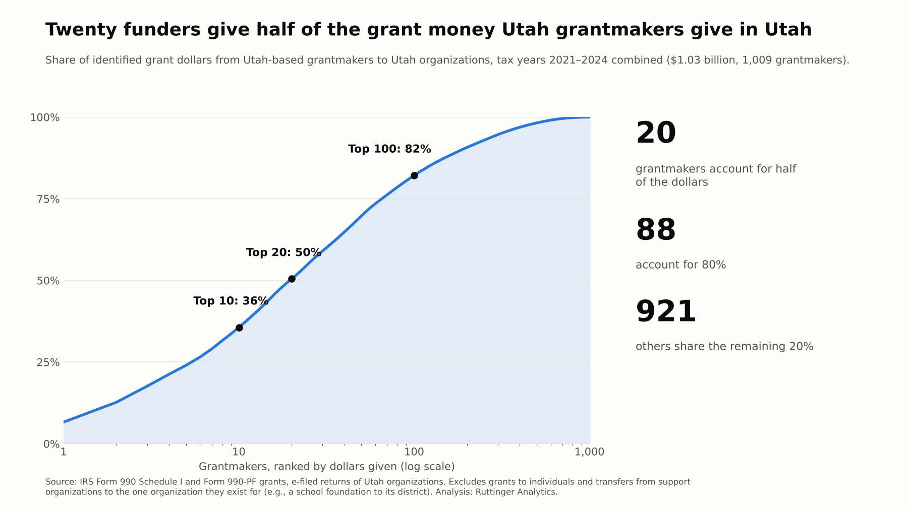
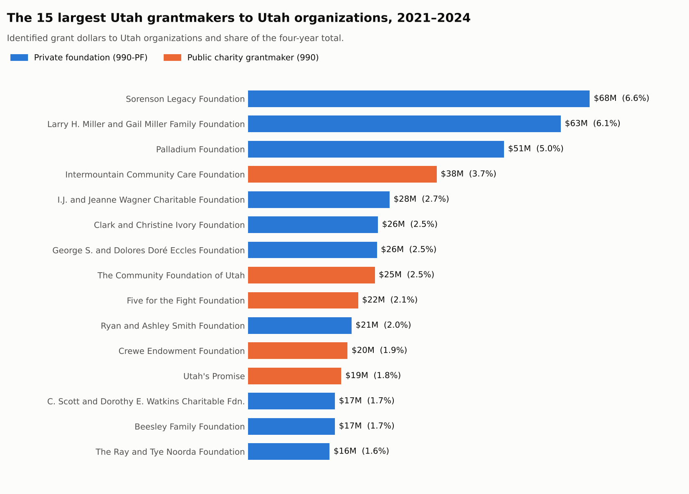

Every private foundation lists its grants on Form 990-PF, and every public charity that makes grants over $5,000 lists them on Schedule I of its Form 990. Put four years of those lists together for Utah and you can see who funds the state's nonprofits, at least among funders based here.

In the filings I could see, **about 1,000 Utah grantmakers gave $1.03 billion to Utah organizations from 2021 through 2024. Twenty of them gave half of it.**

## The number

{fig-alt="Cumulative share curve of grant dollars by grantmaker rank on a log scale. The top 10 grantmakers give 36%, the top 20 give 50%, and the top 100 give 82% of $1.03 billion."}

| Utah grantmakers to Utah organizations, 2021–2024 | |
|---|---:|
| Grantmakers | 1,009 |
| Grant dollars | $1.03 billion |
| Organizations receiving grants | about 8,300 |
| Share from the top 10 grantmakers | 36% |
| Grantmakers that account for half the dollars | **20** |
| Grantmakers that account for 80% | 88 |

The other 921 grantmakers share the remaining 20%. Most of them are small family foundations: the median grantmaker gave about $44,000 to Utah organizations in 2023.

The pattern holds year to year, even though the totals move around with big one-time gifts. The top 10 accounted for between 39% and 54% of the dollars in each single year from 2021 through 2024.

## Who they are

{fig-alt="Bar chart of the 15 largest Utah grantmakers to Utah organizations, 2021 to 2024, led by Sorenson Legacy Foundation ($68M), the Larry H. Miller and Gail Miller Family Foundation ($63M), and Palladium Foundation ($51M)."}

About three-quarters of the dollars come from private foundations, most of them family foundations. The rest come from public charities that make grants, such as community foundations, United Ways and health-system foundations. Naming these funders is fair game: they are public grantmakers, and their grants are public record.

## The money that isn't really grantmaking

The raw grant lists add up to much more than $1 billion. Over the four years, Utah filers reported **$2.3 billion** in grants to Utah organizations. More than half of that is money moving within one organizational family, not money a funder chose to give:

- **Support organizations funding the one organization they exist for:** a school district's foundation paying the district, a hospital's foundation paying the hospital, a ski team's foundation paying the team. I set aside 79 grantmakers that sent 80% or more of their Utah grants to a single recipient.
- **Transfers to an organization with the grantmaker's own name,** such as a charity paying its own building LLC or a parent paying its affiliate.

Those flows are real money, but they say nothing about who decides what the sector works on. The figures above leave them out.

## What it means

**For funders,** concentration is influence. When 20 organizations account for half the grant dollars, their application forms, reporting templates and site visits set the routine for a large share of Utah's nonprofits. Whatever those 20 ask grantees to measure becomes what gets measured.

**For nonprofits,** it's a small pool. If a handful of funders account for most of the money in your field, losing one of them is a strategic event, not a fundraising setback. (That's next week's post.)

**For everyone,** this is only part of the picture. Individual donors, government contracts, fees and national foundations outweigh Utah grantmakers for most organizations. More on that below.

## What this says about analytics maturity

This is the *questions* stage, seen from the funder's side. Last month's post found that only about 2 in 100 Utah charities report an outcome in their 990. One reason is that grant reports usually ask for activities and counts: people served, events held, dollars spent. Organizations measure what they are asked to report.

That makes a concentrated funding base an opportunity. If the largest grantmakers asked one or two outcome questions in their reports and helped grantees build the data habits to answer them, practice could change across a big share of the sector without anyone launching a new program. A practical step for funders: look at your own reporting template and ask which questions you actually use to make decisions. Cut the rest, and add the one outcome question you wish you could answer.

## What the data can't see

- **Only Utah-based grantmakers that e-file are included.** National foundations that fund Utah organizations file their returns from other states, so they don't appear here. Neither do government grants, corporate giving programs or donations from individuals.
- **Giving by the Church of Jesus Christ of Latter-day Saints doesn't appear.** Churches don't file 990s. Grants *to* the Church from Utah foundations do appear.
- **Some money is counted twice.** About 1 in 6 dollars went to a recipient that is itself a Utah grantmaker, which then regranted some of it.
- **Recipients are matched by the address on the grant line.** About 8% of grant lines have no state and are left out. Grants to individuals (mostly scholarships) are excluded.
- **"Support organization" is a rule, not a legal status.** Anyone sending 80% of $500,000 or more to one recipient is set aside, which catches a few family foundations devoted to one cause. The concentration result holds with or without them.
- **One foreign filer was removed.** A German foundation that files a 990-PF from a Utah address reported large grants to a placeholder recipient; they aren't Utah giving.

## Method

<details>
<summary>Data and definitions</summary>

- **Grants:** Form 990-PF grants paid and Form 990 Schedule I grants to organizations, from e-filed returns of Utah organizations in the IRS Exempt Organizations Business Master File, tax years 2021–2024. One return per grantmaker per year (the most recently filed, so amended returns replace originals). Cash and non-cash amounts are combined.
- **Utah recipients:** grant lines with a Utah recipient address. Grants to individuals are excluded.
- **Within-family transfers excluded:** (1) grantmakers giving $500,000 or more to Utah recipients in the period with at least 80% going to one recipient (recipient spelling variants grouped), and (2) grants from a public charity to a recipient whose name contains the grantmaker's own distinctive name or acronym.
- **Concentration:** grantmakers ranked by total dollars to Utah recipients over 2021–2024; cumulative share of the total.

</details>

<details>
<summary>The query (Cypher, against the Utah 990 graph)</summary>

```cypher
// Top grantmakers to Utah recipients, 2021-2024 (before the within-family exclusions)
MATCH (f:Organization)-[g:GRANTED]->(r:Organization)
WHERE g.tax_year IN [2021, 2022, 2023, 2024] AND r.state = 'UT'
WITH f, sum(coalesce(g.cash_amount, 0) + coalesce(g.noncash_amount, 0)) AS dollars
ORDER BY dollars DESC
WITH collect({funder: f.name, dollars: dollars}) AS ranked, sum(dollars) AS total
UNWIND range(0, size(ranked) - 1) AS i
WITH ranked[i] AS row, i + 1 AS rnk, total,
     reduce(s = 0.0, x IN ranked[0..i + 1] | s + x.dollars) AS running
RETURN rnk, row.funder, row.dollars, round(100.0 * running / total, 1) AS cumulative_pct
LIMIT 50;
```

</details>

## Where does your organization stand?

Whether you fund or are funded, the data habits start with the questions you ask. [Take the short analytics maturity assessment](https://clarkruttinger.info/assessment/?src=blog) to see where your organization's data practices are strong and where the next step is.

*Next week: one renewal from a crisis. How many Utah charities depend on a single grantmaker for half of what they raise.*
